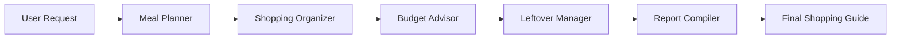

<h1 align="center">🤖 CrewAI Agents: From First Crew to Structured Multi-Agent Systems</h1>

<p align="center"><b>A hands-on learning path for building collaborative and autonomous AI agent teams with CrewAI</b></p>

<p align="center">
  
  
  
  
  
  
</p>

<p align="center"><i>*Build agents that research, organize, plan and collaborate*</i></p>

<p align="center">
  <a href="#-getting-started">Getting Started</a> •
  <a href="#-learning-path">Learning Path</a> •
  <a href="#-notebooks">Notebooks</a> •
  <a href="#-key-concepts">Concepts</a> •
  <a href="#-contributing">Contributing</a>
</p>


## 📌 Overview

This repository shows a progression from CrewAI fundamentals to a production-style, multi-agent pipeline:

| # | Project | What it demonstrates |
|---|---------|----------------------|
| 1 | **CrewAI 101: Research → Content Pipeline** | Agents, tasks, crews, sequential workflows, token-usage tracking |
| 2 | **Agent-Level vs Task-Level Tools** | Tool-assignment strategies, PDF RAG search, custom `@tool` functions |
| 3 | **Structured Meal & Grocery Planner** ⭐ | Pydantic structured outputs, YAML config, `@CrewBase`, 5-agent workflow |

---

## 🧩 Projects

### 1️⃣ CrewAI 101: Building Multi-Agent AI Systems
A content pipeline in which a **Senior Research Analyst** gathers real-time information through web search, and a **Tech Content Strategist** turns it into an engaging blog post.

- Sequential two-agent workflow with real-time search (`SerperDevTool`)
- Inspecting results: `result.raw`, per-task outputs, and the agent behind each task
- Monitoring prompt, completion, and total token usage
- **Extension:** added a Social Media Strategist agent to produce LinkedIn/X posts from the article

📓 `01_crewai_101_multi_agent_systems.ipynb`

---

### 2️⃣ Agents with Tools vs. Tasks with Tools
A customer-service chatbot for a fictional restaurant, "The Daily Dish", answering questions from an FAQ PDF, built two ways to compare tool-assignment strategies.

| Approach | How it works | Trade-off |
|----------|--------------|-----------|
| **Agent-centric** | One agent holds a toolbox (PDF search + web search) and decides which to use | Flexible, but less predictable |
| **Task-centric** | Each task is assigned only the tool it needs | Focused, deterministic, easier to debug |

- Semantic PDF search with `PDFSearchTool` and `sentence-transformers/all-MiniLM-L6-v2` embeddings
- Custom tools built with the `@tool` decorator (add / multiply number extraction)
- Interactive chatbot loop with error handling

📓 `02_agent_tools_vs_task_tools.ipynb`

---

### 3️⃣ Structured Meal & Grocery Planner ⭐ *(flagship)*
An end-to-end system that turns a simple request (*"Chicken Stir Fry, 4 servings, $25, no nuts, beginner"*) into a complete, budget-aware shopping guide.



**The five-agent crew**

| Agent | Responsibility | Output |
|-------|----------------|--------|
| 🍳 Meal Planner & Recipe Researcher | Finds recipes matching diet, skill level, and budget | `meals.json` |
| 🛒 Shopping Organizer | Groups ingredients by store section with quantities and prices | `shopping_list.json` |
| 💰 Budget Advisor | Checks costs against budget, suggests savings and swaps | `shopping_guide.md` |
| ♻️ Leftover Manager | Suggests creative uses for leftovers to cut waste | YAML-configured |
| 📋 Report Compiler | Merges all outputs into one user-friendly guide | Final report |

**Engineering highlights**
- **Pydantic models** (`GroceryItem`, `MealPlan`, `ShoppingCategory`, `GroceryShoppingPlan`) enforce consistent, validated agent output instead of free text
- **Hybrid configuration:** the Leftover Manager is defined in `config/agents.yaml` and `config/tasks.yaml`, wired up through a `@CrewBase` class in `leftover.py`
- **Context chaining:** downstream tasks consume upstream outputs via `context=[...]`
- **Dynamic inputs:** `meal_name`, `servings`, `budget`, `dietary_restrictions`, `cooking_skill`
- **Extension:** added a Nutrition Analyst agent (calories and macros) producing `nutrition_analysis.md`
- **Extension:** designed weekly-planning models (`MealType`, `DailyMeals`, `WeeklyMealPlan`, `WeeklyGroceryPlan`)

📓 `03_meal_grocery_planner_crewai.ipynb`

---

## 🛠️ Tech Stack

| Category | Tools |
|----------|-------|
| Agent framework | CrewAI, CrewAI Tools |
| LLMs | IBM watsonx.ai (Granite, Llama 4 Maverick) via LiteLLM |
| Data validation | Pydantic |
| Search and retrieval | SerperDev (web search), PDFSearchTool (semantic search), Hugging Face embeddings |
| Orchestration helpers | LangChain, LangChain Community |
| Environment | Python, Jupyter Notebook, YAML |

---

## 📁 Repository Structure

```
crewai-multi-agent-systems/
├── notebooks/
│   ├── 01_crewai_101_multi_agent_systems.ipynb
│   ├── 02_agent_tools_vs_task_tools.ipynb
│   └── 03_meal_grocery_planner_crewai.ipynb
├── meal_planner/
│   ├── leftover.py              # @CrewBase class (LeftoversCrew)
│   ├── config/
│   │   ├── agents.yaml
│   │   └── tasks.yaml
│   └── outputs/
│       ├── meals.json
│       ├── shopping_list.json
│       ├── shopping_guide.md
│       └── nutrition_analysis.md
├── .env.example
├── requirements.txt
├── LICENSE
└── README.md
```

---

## 🚀 Getting Started

### 1. Clone the repository
```bash
git clone https://github.com/<your-username>/crewai-multi-agent-systems.git
cd crewai-multi-agent-systems
```

### 2. Create a virtual environment
```bash
python -m venv venv
source venv/bin/activate      # Windows: venv\Scripts\activate
```

### 3. Install dependencies
Each notebook was built against a different CrewAI release, so install the pinned versions at the top of the notebook you want to run. Using a separate environment per notebook avoids conflicts.

### 4. Configure your credentials
Create a `.env` file (never commit it):
```env
SERPER_API_KEY=your_serper_key        # get one at serper.dev
WATSONX_API_BASE=https://us-south.ml.cloud.ibm.com
WX_PROJECT_ID=your_watsonx_project_id
WATSONX_APIKEY=your_watsonx_api_key
```

> ⚠️ The original lab notebooks were designed for the IBM Skills Network environment, which provides watsonx access without keys. To run locally, supply your own credentials and replace any hard-coded keys with environment variables.

### 5. Run
```bash
jupyter notebook
```

---

## 💡 Example Run (Meal Planner)

```python
complete_grocery_crew.kickoff(inputs={
    "meal_name": "Chicken Stir Fry",
    "servings": 4,
    "budget": "$25",
    "dietary_restrictions": ["no nuts", "low sodium"],
    "cooking_skill": "beginner",
})
```

---

## 📚 Key Takeaways

- Specialized agents with clear roles outperform one generalist prompt
- Assigning tools **per task** makes workflows more predictable and auditable
- Structured outputs (Pydantic) make agent results reliable enough to feed other systems
- YAML configuration keeps agent logic separate from code and easier to maintain

---

## 🔮 Future Improvements

- Weekly meal planning workflow using the extended Pydantic models
- Streamlit or Gradio front end for the planner
- Persistent storage of past plans and preferences
- Evaluation of output quality and cost across different LLMs

---

## 🙏 Acknowledgements

Built from IBM Skills Network hands-on labs, then extended with additional agents, models, and documentation. Original lab material © IBM Corporation.

---

## 👤 Author

**Samuel**: Data Scientistt | AI/ML Engineer

[](https://www.linkedin.com/in/samuel-olagbenro)
[](https://github.com/SamuelOlagbenro)

---

## 📄 License

Released under the [MIT License](LICENSE).
